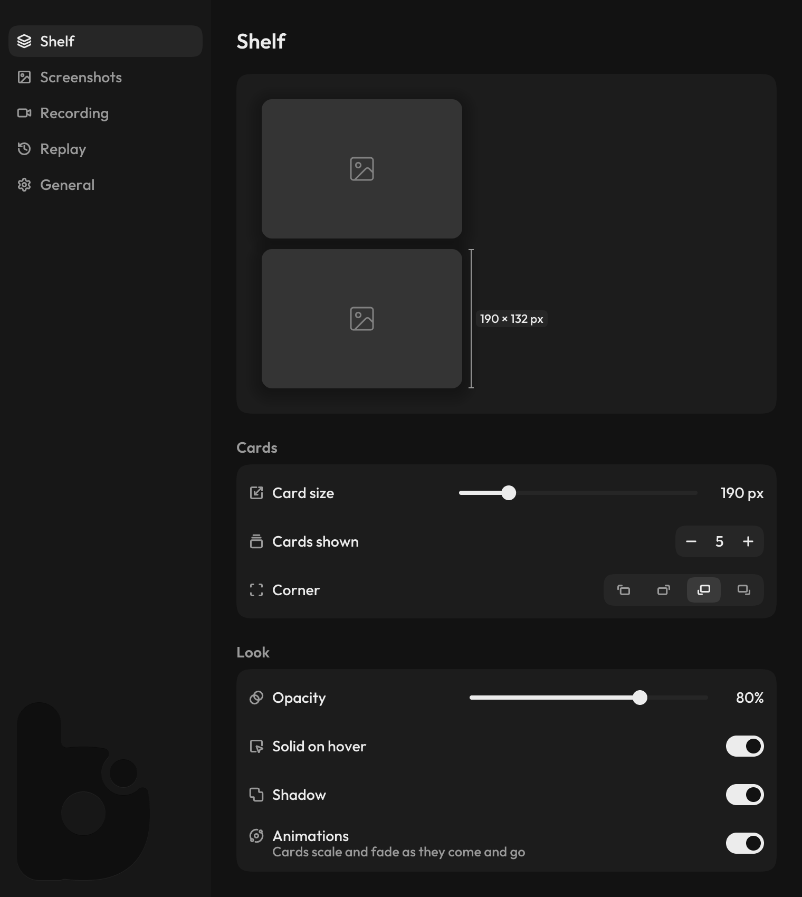
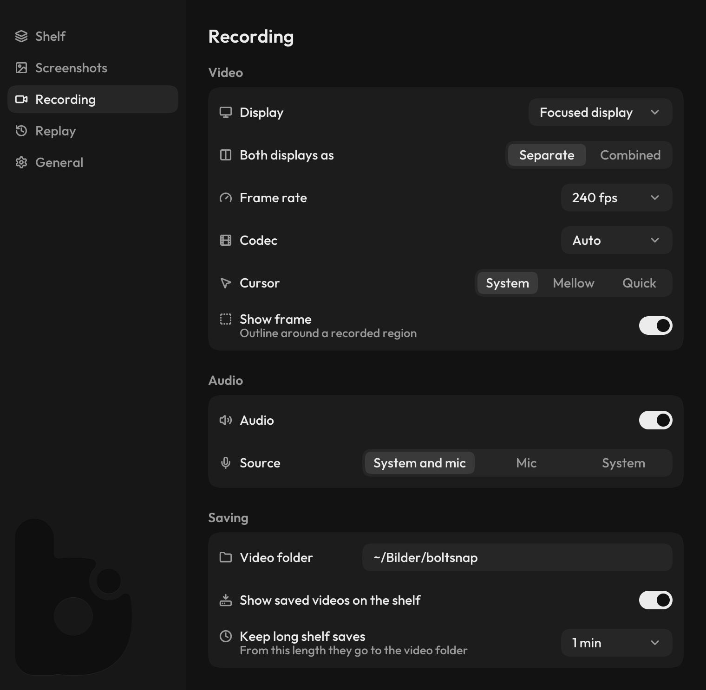
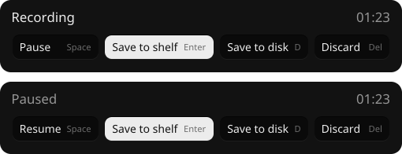
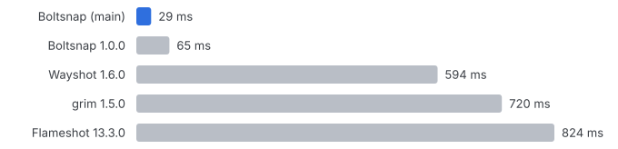

# Boltsnap

Boltsnap is a screenshot and screen-recording tool for Linux, built for
Wayland and also running on X11. Screenshots land on a small shelf in the
corner of the screen, from where you drag them into a chat, open them in an
editor or save them. Capture, region selection, the shelf and the clipboard
all run inside Boltsnap, without grim, slurp or wl-copy.

A full-desktop screenshot to PNG takes 29 ms on a two-monitor desktop, 20 to 28 times faster than grim, Wayshot or Flameshot.

<p align="center">
  
</p>

<p align="center">
  
</p>

<p align="center">
  
</p>

## Features

- Region, window and full-desktop screenshots. The selector freezes all
  monitors, spans monitor edges and, with Ctrl held, snaps to edges in the
  picture and to windows on Hyprland.
- A shelf of recent captures: click a card to open it, drag it into any app,
  right-click to copy it.
- Screen recording with pause and resume, system and microphone audio, and an
  optional smoothed cursor.
- Replay clips on Hyprland (experimental): save the last seconds of the screen,
  or part of it, after the fact.
- A settings window whose changes apply immediately.
- `-o -` pipes the PNG into any editor.

## Speed

<p align="center">
  
</p>

| Tool | Median | vs. Boltsnap |
|------|-------:|-------------:|
| Boltsnap (main) | 29.2 ms | 1.0x |
| Boltsnap 1.0.0 | 65.2 ms | 2.2x |
| Wayshot 1.6.0 | 593.6 ms | 20.3x |
| grim 1.5.0 | 720.4 ms | 24.7x |
| Flameshot 13.3.0 | 823.8 ms | 28.2x |

Full-desktop capture to a PNG file on 3840 × 1080 (two 1080p monitors at
200 Hz and 240 Hz), 20 runs each. Commands, machine and all timings:
[`benchmarks/full-capture-2026-11-01.md`](benchmarks/full-capture-2026-11-01.md).

The shelf daemon keeps its Wayland connection open, so a screenshot starts
without connecting. Where the GPU driver allows it, the monitors are read back
through Vulkan in parallel instead of being copied by the compositor one after
another, and the PNG encoder compresses one band of the image per CPU core.

## Install

Each [release](https://github.com/drvcvt/boltsnap/releases) ships a Debian
package and a standalone binary for x86_64:

```sh
sudo apt install ./boltsnap_<VERSION>-1_amd64.deb
```

From source, on Arch Linux:

```sh
sudo pacman -S --needed rust wayland libxkbcommon mesa pkgconf base-devel gpu-screen-recorder
git clone https://github.com/drvcvt/boltsnap
cd boltsnap
cargo install --path .
```

On NixOS, `nix run github:drvcvt/boltsnap`. Debian build dependencies, the
desktop launcher entry, NixOS details and the experimental Windows build are in
the [installation guide](docs/guide/install.md).

## Usage

```sh
boltsnap                    # select a region
boltsnap window             # pick a window
boltsnap full               # the whole desktop
boltsnap record             # select a region and record it
boltsnap settings           # open the settings window
boltsnap doctor             # check what this system supports
```

Screenshots go to the shelf on Wayland and to the clipboard on X11. To write a
file or hand the image to an editor instead:

```sh
boltsnap full --no-copy -o ~/shot.png
boltsnap area --no-copy -o - | satty --filename -
```

Key bindings for Hyprland:

```
bind = , Print, exec, boltsnap area
bind = CTRL, Print, exec, boltsnap full
bind = ALT, Print, exec, boltsnap record
bind = ALT SHIFT, Print, exec, boltsnap replay save
```

`boltsnap record` while a recording runs opens its controls, so one key starts
and stops recording.

## Guides

- [Taking screenshots](docs/guide/screenshots.md): every command, the region
  selector and snapping, editors.
- [The shelf](docs/guide/shelf.md): what a card does, the daemon, adding images
  and videos from other programs.
- [Screen recording](docs/guide/recording.md): controls, saving, audio, the
  smooth cursor, scripting and config keys.
- [Replay clips](docs/replay.md): setup, controls and limits.
- [Configuration](docs/guide/configuration.md): `config.toml`, the shelf's look
  and the settings window.
- [Installation and compatibility](docs/guide/install.md): all install paths and
  which Wayland compositors work.

## Platform support

| | Screenshots | Region selector and shelf | Recording | Replay |
|---|---|---|---|---|
| Wayland (Hyprland, Sway, Niri) | yes | yes | yes | Hyprland only |
| X11 | yes, to the clipboard | no | no | no |
| Windows | experimental, unmaintained | | | |

Other Wayland compositors work when they offer the needed protocols, listed in
the [compatibility table](docs/guide/install.md#wayland-compatibility).
Recording uses GPU Screen Recorder, or wf-recorder when it is not installed,
and FFmpeg.

## Contributing

See [CONTRIBUTING](.github/CONTRIBUTING.md) and [`AGENTS.md`](AGENTS.md)
before changing code; the [codebase inventory](docs/codebase.md) maps the
modules.

## License

MIT
