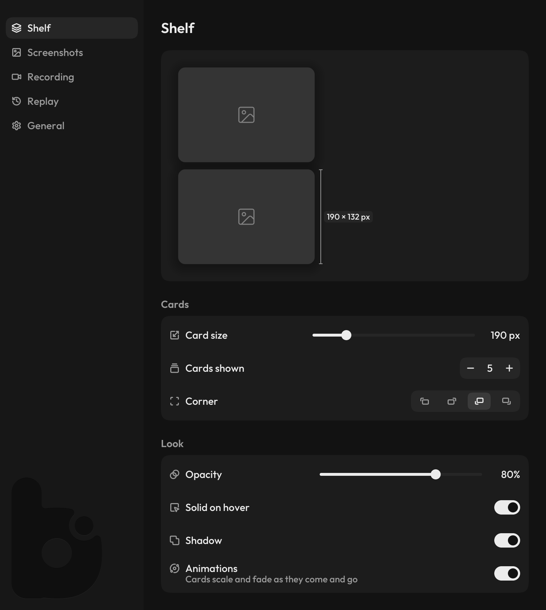
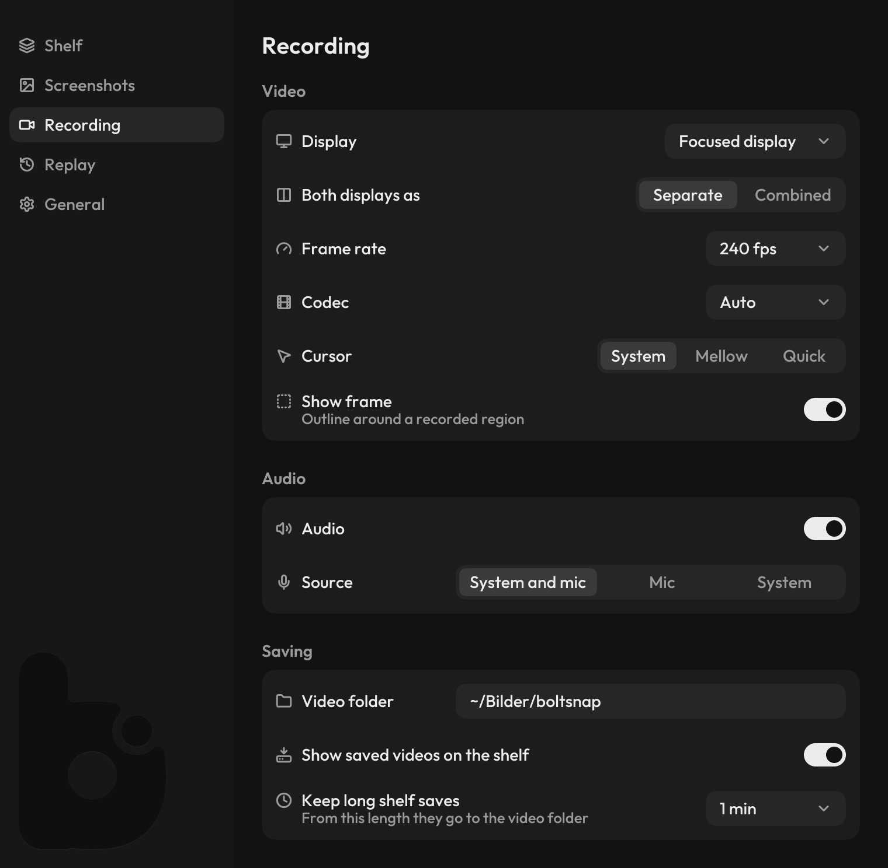

# Configuration

Create `~/.config/boltsnap/config.toml` on Linux or
`%APPDATA%\boltsnap\config.toml` on Windows to set persistent defaults:

```toml
# Directory where the shelf Save button writes timestamped PNGs.
# Default: ~/Bilder/boltsnap
save_dir = "~/Bilder/boltsnap"
```

Two more top-level keys shape a capture (Linux, Wayland):

```toml
copy_to_clipboard = false     # also copy every screenshot, not only onto the shelf
selector_magnifier = "alt"    # "always": the selector's loupe shows without Alt
```

`--copy` / `--no-copy` on the command line go before `copy_to_clipboard`.

Override precedence for `save_dir` (highest to lowest):

1. CLI flag — `--save-dir DIR`
2. Environment variable — `$BOLTSNAP_SAVE_DIR`
3. Config file — `~/.config/boltsnap/config.toml`
4. Built-in default

The daemon watches the file, so an edit applies as soon as it is saved: the
tray follows, recording settings apply to the next recording and `[replay]`
settings after a replay restart (`autostart` at the next daemon start). The tray writes only the key it changed;
comments, other keys and values it did not touch stay as they are.

If an edit leaves the file unparsable while the daemon runs, the daemon keeps
the last valid settings and says which line is wrong in a notification, once
per error. A file that is already broken when the daemon starts falls back to
the defaults.

On Linux the shelf itself can be sized and placed under `[shelf]`; changes
apply live to the cards already showing:

```toml
[shelf]
card_width = 190        # 140 to 380 px; the height follows (190 x 132)
visible_cards = 5       # 1 to 8; more cards stay cached below
corner = "bottom-left"  # bottom-right, top-left or top-right
open_with = "eddy"      # what opens an image card: eddy, satty, swappy, gimp,
                        # krita, pinta or another program; unset or missing:
                        # the desktop's default app (videos always)
card_opacity = 80       # 30 to 100 %, a card at rest
solid_on_hover = true   # the hovered card turns fully opaque
card_shadow = true      # a soft shadow under each card
hover_fade = false      # the hover look fades in and out over 120 ms
animations = true       # cards scale and fade as they come and go
```

The newest card is on top of the stack in every corner. The Windows backend
ignores `[shelf]`: 190 x 132, five opaque cards, bottom left.

Clicking a Linux image card opens it with `open_with`, a video card in the
desktop's default app.
Right-click copies the media. The **Save** button writes it to the
configured save directory.

## Settings window

<p align="center">
  
</p>

<p align="center">
  
</p>

`boltsnap settings` opens one window per session; a second call raises it.
Each row writes its own key to `config.toml` through the daemon as you change
it, so the shelf, the tray and the next recording follow at once; keys you did
not touch, and comments, stay as they are. A row whose key the file sets offers
a reset to the default. Pages:

- **Shelf**: two placeholder cards at their real size, painted by the shelf's
  own code. Hover one, dismiss it with its ✕, and a new card arrives as on the
  shelf; drag the measure beside the front card to change the card size. Below
  are card size, how many cards show, the corner, and the cards' opacity,
  whether they turn solid on hover and fade into it, their shadow and their
  animations.
- **Screenshots**: whether every screenshot also goes to the clipboard, the
  selector's magnifier (with Alt held, or always), what opens an image card
  (the default app or an installed editor: eddy, Satty, swappy, GIMP, Krita,
  Pinta), and the save folder.
- **Recording**: display, frame rate, codec, cursor, frame, audio and where
  recordings go.
- **Replay**: a timeline of what the buffer holds, the buffer's switch, its
  length and memory, whether it starts with Boltsnap, the display, frame
  rate, bitrate and encoder it records with, and under **Load** the CPU and
  memory the running buffer uses, measured. Changes apply when the buffer
  restarts; while it runs with older settings the page offers **Restart
  replay**.
- **General**: the UI font.

`boltsnap settings --render PAGE OUT.png [--scale N] [--size WxH]` draws a page
without a window, as for the images in the [README](../../README.md).
